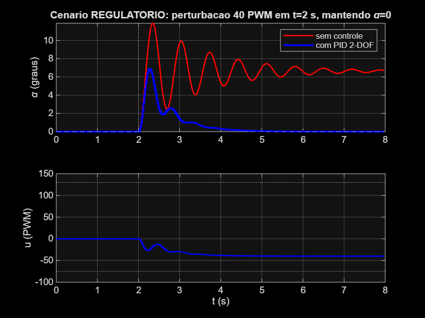

# Sistemas de controle e pêndulo de Furuta

Laboratórios da disciplina de Introdução aos Sistemas de Controle (UFMT, 2026/1) e o trabalho
final: **controle PID de 2 graus de liberdade de um pêndulo de Furuta real**, da identificação do
modelo a partir de ensaios em malha aberta até o controlador discreto rodando num Arduino.

*In English: coursework for an introductory control systems course, plus the final project:
2-DOF PID control of a real rotary (Furuta) pendulum, from open-loop system identification to
a discrete controller running on an Arduino, with dead-zone compensation.*



## Trabalho final: pêndulo de Furuta

O objetivo é manter o pêndulo na posição de baixo (α = 0°) e rejeitar perturbações. O trabalho
passa por todas as etapas de um projeto de controle:

1. **Identificação:** ensaios em malha aberta com o pêndulo solto e com degraus de PWM, coletados
   pela serial. Da oscilação livre saem a frequência natural e o amortecimento, e o processo é
   modelado como um sistema de 2ª ordem ressonante.
2. **Sintonia:** bateria de métodos comparados no modelo. As tabelas empíricas feitas para planta com
   tempo morto (Ziegler-Nichols via FOPDT) dão ganhos absurdos, e os métodos sem derivativo
   instabilizam esta planta; foi adotada uma sintonia robusta com margem de fase de cerca de 53° e
   sem sobressinal.
3. **PID 2-DOF na forma ISA:** peso b = 0,7 na referência do proporcional e derivada só na medição.
4. **Discretização:** Tustin com período de 20 ms, comparação contínuo × discreto, varredura do
   período de amostragem até a instabilidade e a diferença entre Euler e Tustin no filtro do
   derivativo.
5. **Não-linearidades reais:** zona morta assimétrica do motor (+130/−75 PWM) e compensação
   inversa, e o cenário regulatório com perturbação.
6. **Implementação:** controlador discreto em C no Arduino, com interrupção de timer a 50 Hz,
   encoder em quadratura e ponte H.

### Sintonia teórica × sintonia de bancada

Na bancada foram testadas duas sintonias: a teórica, calculada no MATLAB (KC = 57,31, TI =
0,1015 s, TD = 0,4777 s), e uma experimental, ajustada à mão (KC = 90, TI = 1000 s, TD = 0,1 s).
O firmware (`trabalho-final-furuta/V3/Controlador.ino`) usa a experimental. Com TI = 1000 s o
integral fica praticamente desligado, então o controlador de bancada funciona como um PD com
filtro no derivativo e compensação da zona morta. Os comentários do firmware registram os dois
conjuntos de valores.


Trabalho em grupo com Daniel M. Zamarioli e Fabio C. Barbosa Jr.

## Laboratórios

Modelagem e simulação de um tanque atmosférico no Simulink, sintonia de PID, PID 2-DOF,
feedforward, controle em cascata e discretização de controladores (labs 2 a 13), em MATLAB e
Simulink.

## Como rodar

- **Trabalho final (MATLAB):** abra `trabalho-final-furuta/V3/trabalho_final_furuta_v3.m` e rode.
  O script é autocontido (simula por equações a diferenças) e usa a Control System Toolbox. Os
  modelos Simulink da mesma pasta (`modelo_1_linear`, `modelo_2_deadzone`, `modelo_3_naolinear`)
  repetem as simulações em diagrama de blocos.
- **Identificação (Python):** com `numpy`, `scipy`, `pandas` e `matplotlib` instalados,

  ```bash
  cd coleta-dados-furuta
  python estimar_tf.py dados_malha_aberta_soltando2.csv
  ```

  estima a função de transferência a partir de um ensaio e salva o gráfico do ajuste.
  `coletar_dados.py` e os `monitor_tempo_real*.py` fazem a coleta e a visualização pela serial.
- **Controlador (Arduino):** `trabalho-final-furuta/V3/Controlador.ino`, na Arduino IDE, com a
  biblioteca TimerOne.

## Estrutura

| Pasta | Conteúdo |
|---|---|
| `trabalho-final-furuta/V3/` | versão final: script MATLAB, modelos Simulink, firmware e figuras |
| `coleta-dados-furuta/` | coleta serial, ensaios em malha aberta (CSV) e estimação da função de transferência |
| `testes-furuta-pid2dof/` | calibração do modelo não linear em Python e testes do PID 2-DOF na bancada |
| `trabalho-final-furuta/scripts-intermediarios/`, `trabalho-final-furuta/firmwares-intermediarios/` | scripts MATLAB/Python e firmwares das versões intermediárias |
| `coleta-dados-furuta/matlab/` | os mesmos ensaios estimados no MATLAB |
| `coleta-dados-furuta/firmware-malha-aberta/` | firmwares de ensaio em malha aberta |
| `furuta-sistemadecontrole/`, `matlab-trabalho-final-modelos/` | versões anteriores do trabalho final |
| `matlab-sistemas-de-controle/` | laboratórios e as versões V1 a V3 do trabalho final |
| `laboratorios/` | laboratórios avulsos (`avulsos/`) e os labs 9 a 13 (`lab09-a-lab13/`) |

## O que aprendi

- A parte mais difícil foi a diferença entre o motor teórico e o real. Lidar com a zona morta foi
  o maior desafio.
- Os modelos de planta deixam de fora vários fenômenos físicos que acontecem na bancada, e
  incluir todos tornaria o modelo quase impossível de identificar.
- Se fizesse de novo, começaria com uma modelagem mais simples e acrescentaria as camadas mais
  complexas aos poucos. Aprenderia mais e evitaria alguns dos problemas que apareceram.
